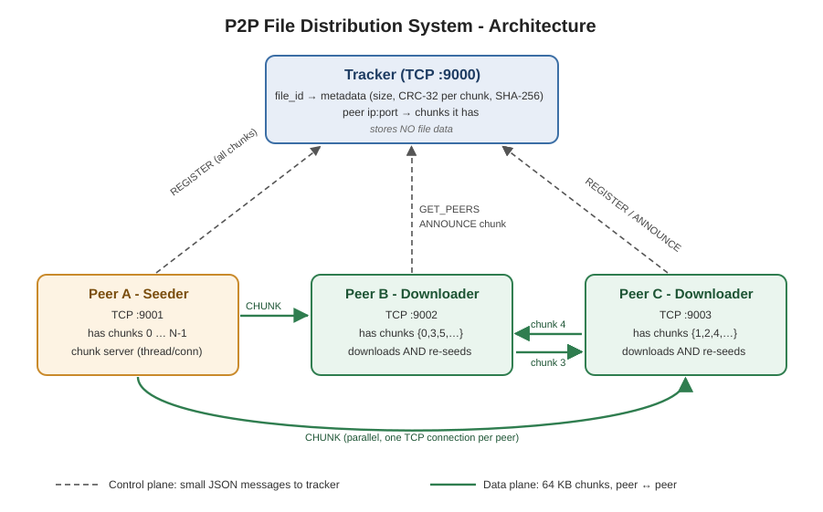
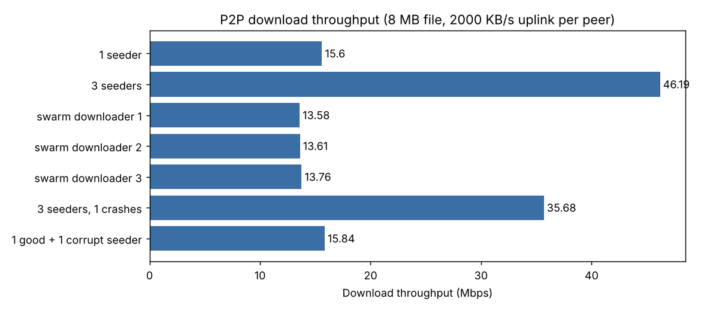

# Peer-to-Peer File Distribution System — Project Report

**Course:** Computer Networks Laboratory (CSE20110), MIT World Peace University, Pune
**Group members:** _Member 1_, _Member 2_, _Member 3_, _Member 4_

---

## 1. Problem statement

In normal client–server file sharing, one server uploads the whole file to every
client. With many clients the server's upload link becomes the bottleneck, and if the
server fails, nobody can download.

We build a **peer-to-peer file distribution system** in which a file is split into
chunks, a peer downloads **different chunks from multiple nodes in parallel**, and every
peer **seeds the chunks it has already received** to others — so the more peers join,
the more upload capacity the system has.

## 2. Objectives

1. Split a file into fixed-size chunks (64 KB) and describe it with metadata.
2. Design an application-layer protocol (message format) over TCP sockets.
3. Download chunks from several peers at once and reassemble the file.
4. Detect corrupted chunks using **CRC-32** and verify the full file with **SHA-256**.
5. Let downloaders re-seed chunks immediately (swarm behaviour).
6. Handle failures: peer crash, corrupted data, tracker down, no seeder left.
7. Measure delay, throughput, latency, jitter and error rate under normal and failure conditions.

## 3. Network architecture / topology

- **Hybrid P2P topology:** a central **tracker** for discovery (control plane) and a
  **mesh** of TCP connections between peers for data (data plane).
- **Tracker** (TCP 9000): stores `file_id → metadata` and `peer (ip:port) → chunk list`.
  It never stores file data.
- **Peer**: runs a **chunk server** (multi-threaded TCP server, one thread per connection)
  and a **downloader** (one worker thread + one persistent TCP connection per remote peer).
- Transport: **TCP** for everything — chunks must arrive complete and in order
  (connection-oriented, reliable). Integrity is still checked end-to-end with CRC
  because a faulty or malicious peer can send wrong data over a perfectly good TCP connection.

### Download algorithm
1. Ask the tracker for the metadata and peer list (`GET_PEERS`).
2. Register with the tracker with 0 chunks (joins the swarm).
3. For each peer, a worker thread repeatedly picks a needed chunk that peer has —
   **rarest-first** (the chunk held by the fewest peers), so rare chunks spread quickly.
4. Verify `CRC-32(chunk)` against the metadata. Mismatch → discard and re-request;
   3 mismatches from the same peer → blacklist it.
5. Write the chunk at offset `index × 64 KB`, then send `ANNOUNCE` to the tracker,
   so other peers can now download that chunk from us.
6. The peer list is refreshed every 0.5 s, so new seeders are picked up automatically.
7. When all chunks are present, verify the SHA-256 of the whole file and continue seeding.

## 4. Protocol / message format design

Every message, tracker or peer, uses the same frame:

| Field | Size | Meaning |
|---|---|---|
| Header length | 4 bytes, big-endian | length of the JSON header |
| Payload length | 4 bytes, big-endian | length of binary data (0 if none) |
| Header | variable | JSON object with a `type` field |
| Payload | variable | raw chunk bytes (only in `CHUNK`) |

The length prefix solves **message framing**: TCP is a byte stream with no message
boundaries, so the receiver reads exactly 8 bytes, then exactly the header, then exactly
the payload.

| Message | Direction | Fields | Reply |
|---|---|---|---|
| `REGISTER` | peer → tracker | port, host, meta, chunks | `OK` + peer_id |
| `ANNOUNCE` | peer → tracker | file_id, peer_id, chunk | `OK` |
| `GET_PEERS` | peer → tracker | file_id | `PEERS` (meta + peer→chunks map) |
| `LIST` | peer → tracker | – | `FILES` |
| `LEAVE` / `REPORT_DEAD` | peer → tracker | peer_id | `OK` |
| `GET_CHUNK` | peer → peer | file_id, index | `CHUNK` (index, crc32 + data) or `NOT_FOUND` |

**Metadata** (like a .torrent file): `file_id` (first 16 hex chars of SHA-256), name,
size, chunk size, number of chunks, CRC-32 of each chunk, SHA-256 of the whole file.

## 5. Implementation

| File | Lines (approx.) | Role |
|---|---|---|
| `common.py` | 100 | framing, CRC-32, SHA-256, metadata |
| `tracker.py` | 100 | tracker server |
| `peer.py` | 385 | chunk server, downloader, CLI |
| `run_tests.py` | 225 | automated tests + metrics + chart |

Python 3 standard library only (`socket`, `threading`, `struct`, `json`, `zlib`, `hashlib`).
To emulate a real access link on localhost, each peer's upload is limited with
`--upload-kbps` (a lock + sleep per chunk ⇒ a fixed upload bandwidth per peer).

## 6. Test cases

Setup: 8 MB random file = 128 chunks of 64 KB; every peer's upload limited to 2000 KB/s;
all processes on one machine (localhost), each peer a separate process on its own port.

| ID | Test | Condition | Expected | Result | Observed |
|---|---|---|---|---|---|
| TC1 | Single source download | Normal | File received, SHA-256 matches | PASS | 4.30 s, 15.6 Mbps |
| TC2 | Multi-source download (3 seeders) | Normal | Chunks from all 3 peers, faster than TC1 | PASS | 1.45 s, chunk split 43 / 43 / 42 |
| TC3 | Swarm: 1 seeder, 3 downloaders | Normal | Downloaders get chunks from each other | PASS | 230 of 384 chunks came from other downloaders |
| TC4 | Seeder crashes mid-download | Failure | Crashed peer dropped, download completes | PASS | 1 peer dropped, done in 1.88 s |
| TC5 | One seeder sends corrupted chunks | Failure | CRC detects, re-fetch, bad peer blacklisted | PASS | 3 CRC errors caught, peer blacklisted, SHA-256 OK |
| TC6 | Tracker unreachable | Failure | Clear error, exit code 2 | PASS | exit code 2 |
| TC7 | Only seeder crashes | Failure | Stops with "stalled" error, no hang | PASS | exit code 1 after 20 s timeout |

## 7. Performance results

| Scenario | Time (s) | Throughput (Mbps) | Avg chunk latency (ms) | Jitter (ms) | Requests | CRC failures | Corrupt % |
|---|---|---|---|---|---|---|---|
| 1 seeder | 4.30 | 15.6 | 32.7 | 0.15 | 128 | 0 | 0.0 |
| 3 seeders | 1.45 | 46.2 | 32.8 | 0.42 | 128 | 0 | 0.0 |
| Swarm downloader 1 | 4.94 | 13.6 | 65.2 | 27.2 | 128 | 0 | 0.0 |
| Swarm downloader 2 | 4.93 | 13.6 | 66.4 | 30.7 | 128 | 0 | 0.0 |
| Swarm downloader 3 | 4.88 | 13.8 | 67.6 | 29.1 | 128 | 0 | 0.0 |
| 3 seeders, 1 crashes | 1.88 | 35.7 | 32.7 | 0.24 | 128 | 0 | 0.0 |
| 1 good + 1 corrupt seeder | 4.24 | 15.8 | 32.6 | 0.09 | 131 | 3 | 2.3 |

*Latency* = time from sending `GET_CHUNK` to receiving the full chunk.
*Jitter* = mean difference between consecutive chunk latencies.
(Exact numbers vary slightly on every run of `run_tests.py`.)

**Observations**
- **Multiple sources ≈ 3× faster:** 3 seeders gave 46.2 Mbps vs 15.6 Mbps from one
  — download speed scales with the number of peers uploading.
- **Swarm effect:** one seeder with a 2 MB/s uplink sending 8 MB to 3 clients
  client–server style would need ≈ 24 MB / 2 MB/s ≈ 12.3 s. In the swarm every
  downloader finished in ≈ 4.9 s (**~2.5× faster**) because 60% of chunks came from
  other downloaders instead of the seeder.
- Swarm latency and jitter are higher: a peer's uplink is shared by several requesters,
  so requests sometimes wait (queuing delay).
- **Crash recovery cost** was small (1.45 s → 1.88 s): the in-flight chunk is
  re-requested from another peer and the remaining load is shared by 2 peers.
- **Corruption** cost only 3 extra requests: each corrupted chunk was re-fetched and
  the bad peer was blacklisted, so the final SHA-256 still matched.

## 8. Wireshark packet-level verification

Capture on the loopback interface with filter
`tcp.port == 9000 || (tcp.port >= 9001 && tcp.port <= 9010)` and verify:
1. TCP **3-way handshake** when a downloader connects to the tracker and to each peer.
2. **Follow TCP Stream** shows our message format: 8-byte length prefix, JSON header
   (`GET_PEERS`, `PEERS`, `GET_CHUNK`, `CHUNK` with `crc32`), then binary chunk data.
3. Tracker connections: one request/response, then FIN. Peer connections: persistent,
   many `GET_CHUNK`/`CHUNK` exchanges.
4. A 64 KB chunk is carried in several TCP segments (segmentation / MSS), with ACKs
   and window updates (flow control).
5. Killing a seeder shows FIN/RST on that connection, and requests continue on the other
   connections.

_(Insert screenshots here.)_

## 9. Syllabus mapping

| Syllabus topic | Where it appears |
|---|---|
| Unit I – Network architectures, topologies | Hybrid P2P (tracker + mesh), client–server vs P2P comparison |
| Unit II – CRC, checksum, error detection | CRC-32 per chunk, SHA-256 for the whole file, retransmission on error |
| Unit III – IP addressing, ports | Peers identified by IP:port; LAN demo across laptops |
| Unit IV – Sockets, TCP connection, reliability, QoS | TCP socket programming, persistent connections, upload rate limiting, throughput/delay/jitter measurement |
| Unit V – Application-layer protocols (HTTP/FTP) | Our own request/response protocol with a header + body format, similar in idea to HTTP/FTP |
| Lab exp. 5 – TCP socket programming | Tracker and chunk server are multi-threaded TCP servers |

## 10. Limitations and future work
- The tracker is a single point of failure for *finding* peers (downloads already
  in progress continue using known peers). A DHT would remove it.
- No encryption or peer authentication.
- Only one tracker request per TCP connection — fine for a lab, but a persistent
  connection would reduce overhead.

## 11. Team contribution

| Member | Contribution |
|---|---|
| _Member 1_ | Protocol / message format design, `common.py`, tracker (`tracker.py`) |
| _Member 2_ | Peer chunk server and parallel downloader (`peer.py`), rarest-first selection |
| _Member 3_ | Test cases, failure scenarios, metrics and chart (`run_tests.py`) |
| _Member 4_ | Wireshark verification, architecture diagram, report and README, demo |

## 12. Likely viva questions

1. **Why TCP and not UDP?** Chunks must arrive complete and in order; TCP gives
   reliability, ordering and flow control. UDP would need our own retransmission.
2. **Why CRC if TCP already has a checksum?** TCP's checksum only protects the bytes
   on one hop of the connection. A bad or buggy peer can send wrong data over a correct
   TCP connection; CRC against trusted metadata catches it end-to-end.
3. **Why the length prefix?** TCP is a byte stream; without it the receiver cannot tell
   where one message ends (framing).
4. **What does the tracker store?** Only metadata and which peer has which chunk — no file data.
5. **Why rarest-first?** Rare chunks get copied quickly, so the file survives even if
   the original seeder leaves.
6. **What happens if a peer crashes?** Its socket errors out, the chunk in flight is
   put back in the queue, the peer is reported dead to the tracker, and other peers continue.
7. **Why does P2P scale better than client–server?** Each new downloader also uploads,
   so total upload capacity grows with the number of peers.
8. **What is jitter here?** Variation in chunk delivery time between consecutive chunks.
